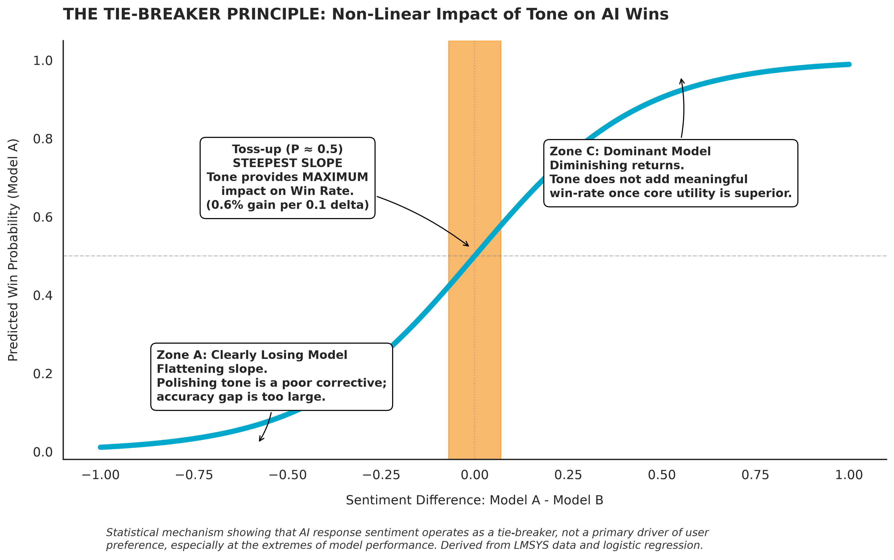

# The Tie-Breaker Principle: Evaluating Sentiment & Tone in High-Volume LLM Benchmarks



## 📌 Executive Summary
This quantitative UXR case study analyzes **50,000+ LLM preference comparisons** from the LMSYS Chatbot Arena dataset to evaluate whether AI response sentiment meaningfully drives user preference. 

While positive tone statistically correlates with model wins ($p < 0.001$), its practical impact follows a **logistic S-curve**. Tone acts primarily as a **tie-breaker** when model capability is at parity ($P \approx 0.50$), yielding near-zero returns when a model is failing or clearly superior.

---

## 🎯 Key Findings

* **Statistically Significant, Modest Size:** Relative positivity increases win odds ($\beta = 0.2416, p < 0.001$), yielding a $\approx +2.4\%$ shift in win odds per $+0.10$ sentiment delta.
* **Domain Invariance:** The interaction term between sentiment and coding tasks is non-significant ($\beta = -0.0863, p = 0.346$), refuting the hypothesis that users demand strictly neutral tone during technical problem-solving.
* **The Tie-Breaker Principle:** Marginal gains peak at parity ($P \approx 0.50$) with $+0.6\%$ win-rate gain per $0.1$ sentiment delta, but flatten completely at extreme performance gaps ($P \to 0$ or $P \to 1$).

---

## 💡 Strategic Product Recommendations

1. **Prioritize Functional Accuracy Over Tone Engineering:** Direct compute and prompt-tuning toward reducing hallucinations and latency; tone adjustments cannot fix a failing model ($P \to 0$).
2. **Apply Tone Polish Solely in Parity Scenarios:** Reserve enthusiastic/warm system prompts as a tie-breaking lever for models operating at feature/accuracy parity with competitors.
3. **Maintain Unified System Prompts Across Domains:** Avoid building domain-specific tone suppression rules for coding tasks, as user preference for polite phrasing remains consistent across technical and general contexts.

---

## 🛠️ Tech Stack & Methodology

* **Data Processing:** `DuckDB` (high-throughput SQL ingestion of LMSYS dataset)
* **Statistical Modeling:** `statsmodels` (Binary Logistic Regression & Average Marginal Effects)
* **Visualization:** `Seaborn` / `Matplotlib` (Custom annotated S-curves exported to editable SVG/PNG)
* **Environment:** Python 3.11+ via `.venv`

---

## 🚀 How to Run Locally

```bash
# 1. Clone the repository
git clone [https://github.com/mhmxd/uxr-lmsys-sentiment-effects.git](https://github.com/mhmxd/uxr-lmsys-sentiment-effects.git)
cd uxr-lmsys-sentiment-effects

# 2. Create and activate virtual environment
python3 -m venv .venv
source .venv/bin/activate  # On Windows: .venv\Scripts\activate

# 3. Install dependencies
pip install -r requirements.txt

# 4. Launch Jupyter Notebook
jupyter notebook notebook.ipynb